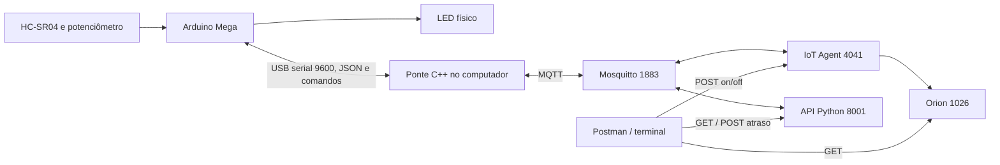

# Indicador de presença — Arduino, MQTT e FIWARE (CP1 + CP2)

Projeto de Edge Computing do segundo semestre, docente Guilherme Salati.
O Arduino Mega mede distância, lê o potenciômetro e controla um LED. A ponte C++
no computador transporta os dados e comandos entre USB, MQTT e FIWARE.
O Postman consulta as APIs e envia comandos; não é servidor nem dashboard.

## Integrantes e entrega

- Gabriel Donato — RM 572320
- Jorge Meert — RM 572179
- Vinicius Araujo — RM 572666

Repositório de entrega: [Edge_Computing_HC-SR04_Project](https://github.com/ViniHADS/Edge_Computing_HC-SR04_Project).
Esta versão prepara uma entrega conjunta CP1/CP2. Não faz publicação automática
no GitHub. O envio por PR e link no Teams é uma etapa posterior à validação.

Display e botão foram dispensados pelo professor, conforme orientação do grupo.
O projeto atual não usa placa ESP32 física; a comunicação MQTT é feita pelo
programa no computador. A pasta ESP32 contém essa camada de comunicação e a
referência da disciplina, e não deve ser apresentada como firmware ESP32.
O computador pode ser Mac/Linux ou Windows com WSL2 e USB encaminhada.
A equivalência dessa configuração à exigência de duas placas do enunciado deve
ser alinhada com o professor. Não há garantia de nota ou dispensa implícita.

[Simulação original no Wokwi](https://wokwi.com/projects/473274436180247553):
referência da montagem/CP1. Não foi atualizada nem validada como cópia exata
deste firmware CP2. A validação desta versão utiliza o Mega físico e testes locais.

## Navegação

- [Arquitetura](#arquitetura)
- [Circuito e controle local](#circuito-e-controle-local)
- [Preparar dependências](#preparar-dependências)
- [Executar com Arduino físico](#executar-com-arduino-físico)
- [GET e POST no Postman](#get-e-post-no-postman)
- [Comandos no terminal](#comandos-no-terminal)
- [Protocolo e mensagens](#protocolo-e-mensagens)
- [Falhas e recuperação](#falhas-e-recuperação)
- [Mock sem placa](#mock-sem-placa)
- [Testes e evidências](#testes-e-evidências)
- [Organização dos arquivos](#organização-dos-arquivos)
- [Preparar a entrega](#preparar-a-entrega)

## Arquitetura



O Arduino executa o controle local perto do sensor, independentemente da rede.
A ponte publica telemetria JSON e UltraLight. O IoT Agent traduz os object_ids
para atributos da entidade `urn:ngsi-ld:dist001:001`. O Orion mantém o estado
mais recente; não implementamos consulta de histórico nesta etapa.

| Porta | Serviço | Finalidade |
| --- | --- | --- |
| 1883 | Mosquitto | MQTT, não HTTP |
| 4041 | IoT Agent | Cadastro e encaminhamento de comandos |
| 1026 | Orion | Consulta dos dados físicos no FIWARE |
| 8001 | API Python (opcional) | JSON completo, saúde e comando de atraso |

A API tem padrão 8000; este passo a passo usa explicitamente 8001.
O MQTT/FIWARE funciona sem iniciar a API auxiliar.

## Circuito e controle local

| Sinal | Pino Mega |
| --- | --- |
| HC-SR04 TRIG | D4 |
| HC-SR04 ECHO | D5 |
| Potenciômetro, terminal central | A0 |
| LED, com resistor em série | D9 |

HC-SR04 e extremos do potenciômetro usam 5 V/GND; todos os GNDs devem estar em
comum. O potenciômetro fornece ADC 0–1023, convertido em referência de 10–100 cm.

A distância é `duracao_us × 0.0343 / 2`, com timeout de 30000 µs e faixa válida
2–400 cm. Dentro da referência (distância estritamente menor), o LED fica em
255, com brilho constante. Igual ou acima da referência, apaga. Fora da faixa,
apaga imediatamente. Uma falha de eco após presença válida preserva o LED por
menos de 300 ms; a primeira leitura após o prazo apaga. Sem presença anterior,
sem eco mantém o LED apagado. Isso tolera falhas breves, sem esconder erros.

`off` desabilita a saída; `on` reativa o controle automático de presença.
**ON significa controle habilitado, não LED obrigatoriamente aceso.**
O brilho real é indicado por `led`/`brilho`. O estado remoto volta a ON após reset.

Os delays existentes foram preservados: 100 ms inicialmente entre ciclos e
pulsos de 2/10 µs para o sensor. A medição e a transmissão também consomem tempo.
Há comentário justificando o delay no teste de watchdog; a aceitação dessa
justificativa para operação normal deve ser discutida na avaliação.

## Preparar dependências

Abra no VSCode a pasta que contém este README. Todos os comandos abaixo partem
dessa raiz. Requisitos: Python 3.10+, CMake 3.18+, compiladores C/C++, make,
curl, tar, Docker e Arduino CLI (ou Arduino IDE instalada para fornecer o CLI).
Windows usa WSL2 para a ponte POSIX; consulte a referência da disciplina para USB.

```sh
sh scripts/setup_local.sh
```

O script instala dependências dentro do projeto e compila a ponte: Paho Python
2.1.0, Paho C 1.3.15, Paho C++ 1.5.3 e Mosquitto 2.0.22. Downloads requerem
internet; a execução demonstrada utiliza serviços locais. Se o ambiente já está
preparado, basta recompilar após alterações C++:

```sh
cmake --build ESP32/ESP32_mqtt_mock/build
```

Para preparar apenas a ponte:

```sh
sh ESP32/ESP32_mqtt_mock/bootstrap_paho.sh
```

### Firmware e gravação

Instale Arduino AVR Boards e **Watchdog de Peter Polidoro 3.0.2** pelo Arduino CLI
ou gerenciadores da Arduino IDE. No CLI disponível no PATH:

```sh
arduino-cli core install arduino:avr
arduino-cli lib install 'Watchdog@3.0.2'
```

No Mac, o executável também pode estar em
`/Applications/Arduino IDE.app/Contents/Resources/app/lib/backend/resources/arduino-cli`.
O script abaixo detecta esse caminho automaticamente. Compile:

```sh
sh scripts/arduino.sh compile
```

Feche screen/Monitor Serial/ponte antes de gravar. Confira a porta na IDE ou:

```sh
ls /dev/cu.*
```

Na montagem validada, a porta é `/dev/cu.usbserial-120` (pode mudar em outro PC):

```sh
sh scripts/arduino.sh upload /dev/cu.usbserial-120
```

Arduino IDE: abra [Arduino/Arduino.ino](Arduino/Arduino.ino), mantendo `src/`
completo. Selecione Mega 2560/ATmega2560. VSCode: **Terminal → Run Task** oferece
compilação e gravação do Mega. Não use um compilador C++ do Mac para gravar o MCU.

### FIWARE

Se os serviços já estão ativos em 1883/4041/1026, reutilize-os:

```sh
docker ps
```

Para uma máquina nova, [infra/compose.yaml](infra/compose.yaml) oferece um ambiente
mínimo CP2 com versões fixadas por digest, Mongo interno e portas em loopback:

```sh
docker compose -f infra/compose.yaml up -d
```

Não inicie esse Compose junto de outro que ocupa as mesmas portas. O Compose
foi validado sintaticamente; os testes funcionais desta entrega usam o Docker
FIWARE existente. Não foi testada uma implantação nova em todas as plataformas.

Cadastre somente o que estiver ausente; primeiro inspecione:

```sh
.venv/bin/python scripts/provision_fiware.py
.venv/bin/python scripts/provision_fiware.py --apply
```

Para acrescentar os atributos CP2 no cadastro existente (sem remover os atuais):

```sh
.venv/bin/python scripts/configure_fiware.py
.venv/bin/python scripts/configure_fiware.py --apply
```

Serviço `smart`, subserviço `/`, API key `TEF`, dispositivo `dist001`, entidade
`urn:ngsi-ld:dist001:001`, tipo `dist001`, UltraLight sobre MQTT. Não refaça
provisionamento manual se o dispositivo já existe: retornará 409.
URLs do Postman usam localhost. Comunicação entre containers usa seus nomes,
como `http://orion:1026` e `http://iot-agent:4041`.

## Executar com Arduino físico

### Terminal 1 — ponte

Após a gravação, mantenha um único processo para o dispositivo e a porta USB:

```sh
./ESP32/ESP32_mqtt_mock/build/ESP32Mock \
  --serial /dev/cu.usbserial-120 --fiware --broker localhost --port 1883
```

Mantenha esse terminal aberto. O novo caminho inclui `ESP32/` porque os arquivos
foram reorganizados segundo o template. Não execute mock para dist001 ao mesmo tempo.

### Terminal 2 — API auxiliar

```sh
.venv/bin/python -m api.server --port 8001 --mqtt-port 1883
```

### Terminal 3 — consultas

Use os comandos a seguir. Para encerrar, Ctrl+C nos terminais da ponte e API.
O Arduino continua executando o firmware enquanto estiver alimentado.

## GET e POST no Postman

A coleção existente foi preservada. Os itens 7/8 que consultam esta entidade
agora podem exibir dados físicos quando a ponte está no modo `--serial --fiware`.
Não é necessário alterar suas URLs de consulta.

Em todas as requisições FIWARE:

```text
fiware-service: smart
fiware-servicepath: /
```

GET: Body vazio e sem Content-Type. POST: Body raw → JSON e
Content-Type application/json. JSON não aceita comentários `//`.

| Método | URL | Função |
| --- | --- | --- |
| GET | `http://localhost:4041/iot/about` | IoT Agent ativo |
| GET | `http://localhost:4041/iot/devices/dist001` | Cadastro e atributos |
| GET | `http://localhost:1026/v2/entities/urn:ngsi-ld:dist001:001/attrs` | Atributos completos |
| GET | `http://localhost:1026/v2/entities/urn:ngsi-ld:dist001:001?type=dist001&options=keyValues` | Valores simples |
| GET | `http://localhost:1026/v2/entities/urn:ngsi-ld:dist001:001/attrs/state` | Habilitação do controle |
| GET | `http://localhost:1026/v2/entities/urn:ngsi-ld:dist001:001/attrs/led` | Saída real do LED |
| GET | `http://localhost:1026/v2/entities/urn:ngsi-ld:dist001:001/attrs/distance` | Última distância válida |
| GET | `http://localhost:1026/v2/entities/urn:ngsi-ld:dist001:001/attrs/potentiometer` | ADC real |

Para outros campos, substitua o nome final por reference, sensor_status ou
communication. Acrescente `/value` para obter somente o valor.

Comando físico:

```text
POST http://localhost:4041/v2/op/update
```

Desligar:

```json
{
  "actionType": "update",
  "entities": [
    {
      "id": "urn:ngsi-ld:dist001:001",
      "type": "dist001",
      "off": { "type": "command", "value": "" }
    }
  ]
}
```

Para ligar, troque somente a propriedade `off` por `on`. HTTP 204 significa
aceitação, com Body vazio. Depois consulte `off_status`/`on_status` e seus
horários: espere **OK novo**, state correspondente e LED zero após off.
A ponte imprime `Arduino confirmou off/on (id N)` somente após ACK serial.
Sem confirmação em cinco segundos, publica ERROR. Dados antigos com OK não
confirmam um comando atual.

A requisição antiga "6. Switching on the Smart Lamp" da coleção aberta estava
apontando para Lamp:001. Ela não foi alterada. Use o POST para dist001 descrito
acima ou os comandos do terminal. As [coleções locais](postman/) são referências
preservadas; a coleção da API tem baseUrl padrão 8000 e precisa da URL de teste correta.

API auxiliar, sem headers FIWARE:

| Método | URL | Resultado |
| --- | --- | --- |
| GET | `http://localhost:8001/health` | MQTT conectado; não confirma presença da placa |
| GET | `http://localhost:8001/telemetria` | JSON físico completo e idade da amostra |
| POST | `http://localhost:8001/comandos/atraso` | Body `{"atraso_ms":100}`; HTTP 202 confirma envio MQTT |

## Comandos no terminal

Consultar dados FIWARE:

```sh
curl -sS -H 'fiware-service: smart' -H 'fiware-servicepath: /' \
  'http://localhost:1026/v2/entities/urn:ngsi-ld:dist001:001?type=dist001&options=keyValues' \
  | .venv/bin/python -m json.tool
```

Desligar:

```sh
curl -i -X POST http://localhost:4041/v2/op/update \
  -H 'fiware-service: smart' -H 'fiware-servicepath: /' \
  -H 'Content-Type: application/json' \
  -d '{"actionType":"update","entities":[{"id":"urn:ngsi-ld:dist001:001","type":"dist001","off":{"type":"command","value":""}}]}'
```

Ligar:

```sh
curl -i -X POST http://localhost:4041/v2/op/update \
  -H 'fiware-service: smart' -H 'fiware-servicepath: /' \
  -H 'Content-Type: application/json' \
  -d '{"actionType":"update","entities":[{"id":"urn:ngsi-ld:dist001:001","type":"dist001","on":{"type":"command","value":""}}]}'
```

Consultar JSON ou alterar atraso normal:

```sh
curl -sS http://localhost:8001/telemetria | .venv/bin/python -m json.tool
curl -i -X POST http://localhost:8001/comandos/atraso \
  -H 'Content-Type: application/json' -d '{"atraso_ms":100}'
```

Observar MQTT no Docker existente:

```sh
docker exec -it fiware-mosquitto mosquitto_sub \
  -h localhost -p 1883 -t '/TEF/#' -t '/ul/TEF/#' -v
```

No Compose de referência deste projeto, a alternativa é
`docker compose -f infra/compose.yaml exec mosquitto mosquitto_sub -t '/TEF/#' -t '/ul/TEF/#' -v`.
Ctrl+C encerra somente a visualização.

## Protocolo e mensagens

### USB serial

9600 baud, 8N1, uma mensagem por linha LF ou CRLF. O firmware limita comandos a
47 caracteres e 32 bytes processados por ciclo; a ponte limita linhas a 512 bytes.
Logs legíveis são ignorados pela ponte. A ordem dos campos JSON é parte do contrato.

```json
{"distancia_cm":25.00,"referencia_cm":54,"brilho":255,"status":"ok","uptime_ms":1200,"potenciometro":501,"habilitado":true,"comunicacao":"online"}
```

| Campo | Significado |
| --- | --- |
| distancia_cm | cm ou null se inválida |
| referencia_cm | limite escolhido, 10–100 cm |
| brilho | saída física 0/255 |
| status | ok, sem_eco ou fora_faixa |
| uptime_ms | tempo desde inicialização, usado também para observar reset |
| potenciometro | ADC bruto real 0–1023 |
| habilitado | controle permitido por on/off |
| comunicacao | online, mqtt_offline ou ponte_offline |

Sem eco durante a tolerância pode coexistir com brilho 255. Fora da faixa sempre
usa brilho zero. O formato antigo de cinco campos permanece aceito para mocks
legados; nesse caso a origem na API é `mock_ou_legado`, nunca Arduino comprovado.

| Frame recebido no Mega | Ação |
| --- | --- |
| `100` + newline | atraso normal em ms; inteiros 100–60000 |
| `off\|42` + newline | desabilita LED, com ID de correlação |
| `on\|43` + newline | reabilita controle automático |
| `hb\|online` + newline | ponte conectada ao MQTT |
| `hb\|offline` + newline | ponte informa MQTT indisponível |

A ponte envia heartbeat aproximadamente a cada segundo enquanto recebe telemetria
serial recente. Após mais de cinco segundos sem uma leitura válida, suspende o
heartbeat para deixar o bootloader concluir a inicialização após watchdog; retoma
com a primeira leitura válida. Sem heartbeat por cinco segundos, o Arduino indica
ponte_offline na telemetria. Não pisca o LED para
sinalizar falha nem interrompe o controle local. Após aplicar PWM, o Arduino responde:

```json
{"comando":"off","id":42,"resultado":"OK"}
```

A ponte só confirma o comando pendente com mesmo nome e ID; ACK incorreto é
ignorado. Um comando simultâneo ou firmware sem telemetria recente gera ERROR.
Os comandos numéricos de atraso continuam sem ACK físico na API HTTP.

### MQTT / UltraLight

| Tópico padrão | Payload |
| --- | --- |
| `/TEF/exemplo001/attrs/telemetria` | JSON para API Python |
| `/TEF/exemplo001/cmd` | atraso numérico |
| `/TEF/dist001/attrs` | `s\|ON\|l\|255\|d\|25\|p\|501\|r\|54\|e\|ok\|c\|online` |
| `/TEF/dist001/cmd` | `dist001@off\|` / `dist001@on\|` |
| `/ul/TEF/dist001/cmdexe` | `dist001@off\|OK` ou ERROR |

| Object ID | Atributo Orion | Unidade / significado |
| --- | --- | --- |
| s | state | ON/OFF: habilitação |
| l | led | PWM aplicado |
| d | distance | cm, última leitura válida |
| p | potentiometer | ADC bruto real |
| r | reference | cm |
| e | sensor_status | estado da leitura |
| c | communication | saúde da comunicação |

Quando a distância é inválida, não publicamos d no UltraLight: Orion mantém a
última distância válida. **Consulte sensor_status e TimeInstant antes de usar
distance.** A API 8001 mostra null explicitamente. Nunca interpretar esse valor
armazenado no Orion como leitura válida durante sem_eco/fora_faixa.

Publicações usam QoS 0 e não são retidas; não há garantia de cada amostra durante
falhas, histórico persistente ou fila de comandos offline. Comandos retidos são
ignorados. Publicação física limitada a uma amostra por segundo; a placa mede em
seu ciclo local. Não esperar que o GET reflita cada medição individual.

## Falhas e recuperação

| Situação | Comportamento |
| --- | --- |
| Sem eco / fora da faixa | erro no JSON, log e sensor_status; LED segue regra segura/tolerância |
| Sem ACK de on/off em 5 s | ERROR no resultado FIWARE; sem confirmação falsa |
| Broker indisponível | ponte reconecta; heartbeat informa mqtt_offline; API retorna health 503 e rejeita comandos |
| Ponte encerrada | Arduino indica ponte_offline após 5 s; API marca amostra antiga |
| USB removida | ponte informa usb_desconectada ao FIWARE quando MQTT disponível e encerra; reconectar e reiniciar |
| Placa sem telemetria por 5 s | ponte publica communication sem_telemetria; API marca desatualizada |
| API reiniciada | cache em memória é perdido; telemetria 404 até nova amostra |

Uma consulta 200 não prova atualização. Veja idade_segundos/desatualizada na API
ou TimeInstant/communication/sensor_status no Orion. Se a ponte ou MQTT param,
Orion pode manter o último estado; não há last will neste contrato.

### Watchdog

O watchdog AVR tem timeout de um segundo. O ciclo alimenta depois do delay;
2000 ms é um teste intencional de reset, não um intervalo normal para o Mega.
Na inicialização, uma rotina .init3 limpa WDRF/desativa WDT antes de setup;
setup o reativa. Não foi modificado o bootloader.

**Recuperação validada nesta placa em 13/10/2026:** o heartbeat contínuo da ponte
interferia na retomada após o reset. A ponte agora suspende esse envio quando
não recebe telemetria por mais de cinco segundos. Dois ensaios físicos completos
passaram: uptime 20112 → 417 ms e 123590 → 417 ms, com retomada automática das
leituras e restauração do atraso para 100 ms. O segundo ensaio foi executado no
terminal integrado do VSCode. Nenhum bootloader ou fuse foi gravado.

Durante a demonstração, aguarde a retomada sem enviar novos comandos. O teste
permite até 20 segundos para observar a recuperação, incluindo a inicialização
do bootloader e a publicação MQTT. Consulte o [relatório](docs/VALIDACAO_CP2.md)
para distinguir os resultados finais das falhas observadas durante a investigação.

Teste opt-in, com placa/ponte/API ativas:

```sh
.venv/bin/python scripts/verify_hardware.py --watchdog
```

O teste envia off/on, verifica ACK novo no Orion, envia atraso 2000 e observa
uptime voltar a um valor menor e retomar crescimento. Ao concluir restaura atraso
100 ms. Se o firmware não retomar, pare ponte/API, recupere a placa e investigue
bootloader/hardware; não marcar sucesso por receber apenas HTTP 202.

## Mock sem placa

```sh
./ESP32/ESP32_mqtt_mock/build/ESP32Mock --mock --fiware --broker localhost --port 1883
```

Não executar ao mesmo tempo que a ponte física para dist001. O mock gera distância
20–120 cm, referência fixa 100 cm, potenciômetro virtual 1023 e brilho proporcional
original. Não mede o HC-SR04 nem valida watchdog físico. Os on/off atuam no mock.

Para API isolada sem FIWARE, em portas livres:

```sh
.venv/bin/python scripts/run_local.py --mock --mqtt-port 1884 --api-port 8002
```

O inicializador cria broker, ponte e API próprios; não reutiliza Docker e não
oferece modo FIWARE. Ctrl+C encerra os três. `--mock-manual` recebe JSON digitado,
sem executar on/off; `--help` lista opções de porta/prefixo/API key/device ID.

## Testes e evidências

Lógica, protocolo, estados do sensor, presença, ADC real, heartbeat e comandos:

```sh
.venv/bin/python -B -m unittest discover -s tests -v
```

Integrações em portas temporárias, sem placa:

```sh
.venv/bin/python -B tests/test_http_e2e.py
.venv/bin/python -B tests/test_physical_bridge_e2e.py
.venv/bin/python -B tests/test_mqtt_e2e.py \
  --bridge ./ESP32/ESP32_mqtt_mock/build/ESP32Mock \
  --mosquitto .local/bin/mosquitto \
  --pub .local/sources/mosquitto-2.0.22/client/mosquitto_pub \
  --sub .local/sources/mosquitto-2.0.22/client/mosquitto_sub
```

FIWARE com mock: pare outra ponte de dist001 antes de executar:

```sh
.venv/bin/python -B tests/test_fiware_e2e.py
```

Hardware real, com ponte física e API já iniciadas:

```sh
.venv/bin/python -B scripts/verify_hardware.py
```

As suítes simuladas não verificam montagem ou brilho visual. A prova física e os
resultados desta versão estão no [relatório de validação](docs/VALIDACAO_CP2.md).

## Organização dos arquivos

Estrutura inspirada no [template oficial](https://github.com/gsalati/eccs_projeto_2_semestre):

| Arquivo / pasta | Responsabilidade |
| --- | --- |
| [Arduino/Arduino.ino](Arduino/Arduino.ino) | setup/loop e ordem de atuação/ACK/telemetria |
| [Arduino/src/Configuracao.h](Arduino/src/Configuracao.h) | pinos, limites e prazos |
| [ControleBrilho.cpp](Arduino/src/ControleBrilho.cpp) | presença, ADC real, habilitação |
| [SensorDistancia.cpp](Arduino/src/SensorDistancia.cpp) | HC-SR04 e erros |
| [ComandosSerial.cpp](Arduino/src/ComandosSerial.cpp) | parser limitado e ACK após atuação |
| [Comunicacao.cpp](Arduino/src/Comunicacao.cpp) | heartbeat e saúde do link |
| [Telemetria.cpp](Arduino/src/Telemetria.cpp) | logs e JSON |
| [Supervisao.cpp](Arduino/src/Supervisao.cpp) | watchdog e proteção de inicialização |
| [Ponte C++](ESP32/ESP32_mqtt_mock/src/) | comunicação do computador, independente do firmware |
| [esp32.cpp](ESP32/ESP32_mqtt_mock/src/esp32.cpp) | coordenação UART/MQTT e confirmação |
| [protocol.cpp](ESP32/ESP32_mqtt_mock/src/protocol.cpp) | contrato validado, versões 1/2 e ACK |
| [ultralight.cpp](ESP32/ESP32_mqtt_mock/src/ultralight.cpp) | tradução dos dados para FIWARE |
| [API Python](api/) | HTTP, cache e comandos de atraso |
| [infra](infra/) | Compose mínimo de referência |
| [scripts](scripts/) | preparação, cadastro, gravação, validação e pacote |
| [tests](tests/) | lógica e integração |
| [postman](postman/) | coleções preservadas |
| [Dashboard](Dashboard/README.md) | reservado ao CP3, ainda não desenvolvido |
| [Roteiro de apresentação](docs/APRESENTACAO.md) | explicação e demonstração em sala |
| [Referência original](ESP32/ESP32_mqtt_mock/reference/) | material da disciplina preservado |

Os .h declaram interfaces; os .cpp implementam cada bloco. O sketch e a ponte
são programas diferentes. Dependências .deps, build, .venv e .local são geradas,
não devem ser enviadas como código fonte nem alteradas para refatorar a aplicação.

## Preparar a entrega

```sh
.venv/bin/python scripts/package_delivery.py
```

Gera `output/CP1_CP2_Entrega.zip` com fontes, documentação, testes e configurações,
sem dependências/binários. Não cria PR nem publica. Antes de enviar:

1. Conferir o conteúdo no repositório de entrega informado acima, preservando o
   histórico do CP1 e substituindo o sketch antigo pela estrutura modular.
2. Criar branch para a entrega conjunta e incluir apenas os arquivos preparados.
3. Fazer commit/push dessa branch e abrir PR; não fazer commit direto na main.
4. Garantir acesso do professor gsalati e regras de revisão no repositório.
5. Enviar o link do PR no Teams conforme orientação do professor.

A entrega conjunta é submetida por PR para a main. A revisão, o merge, a
configuração de acesso/proteção e o envio do link no Teams devem ser conferidos
como etapas da entrega. Dashboard e sua apresentação pertencem ao CP3. A entrega conjunta e as dispensas devem seguir o combinado com
professor; o enunciado original prevê PRs por checkpoint.

## Referências

- [Projeto ESP32_mqtt_mock da disciplina](https://github.com/gsalati/Edge-Computing-Computer-Systems/tree/main/ESP32_mqtt_mock)
- [Template de entrega](https://github.com/gsalati/eccs_projeto_2_semestre)
- [IoT Agent UltraLight](https://fiware-iotagent-ul.readthedocs.io/en/latest/usermanual.html)
- [Orion NGSIv2](https://fiware-orion.readthedocs.io/en/master/user/walkthrough_apiv2.html)
- [Arduino CLI](https://arduino.github.io/arduino-cli/)
- [Mosquitto](https://mosquitto.org/documentation/)
